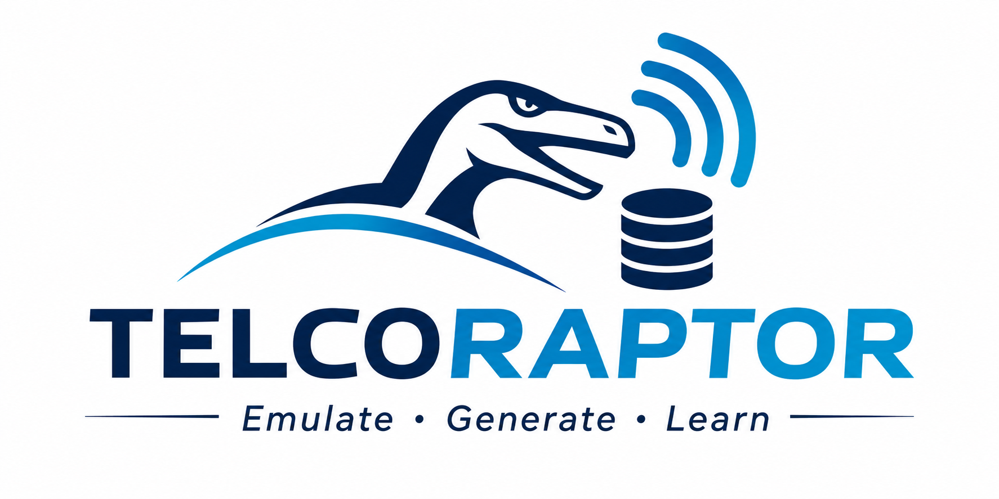

# TELCORAPTOR

TELCORAPTOR is an open-source, configurable generator of site-specific or synthetic city 5G / beyond-5G HetNet scenarios that evaluates deployments and exports valuable results (e.g., path loss, traffic load per cell, antenna specifications) as datasets.
